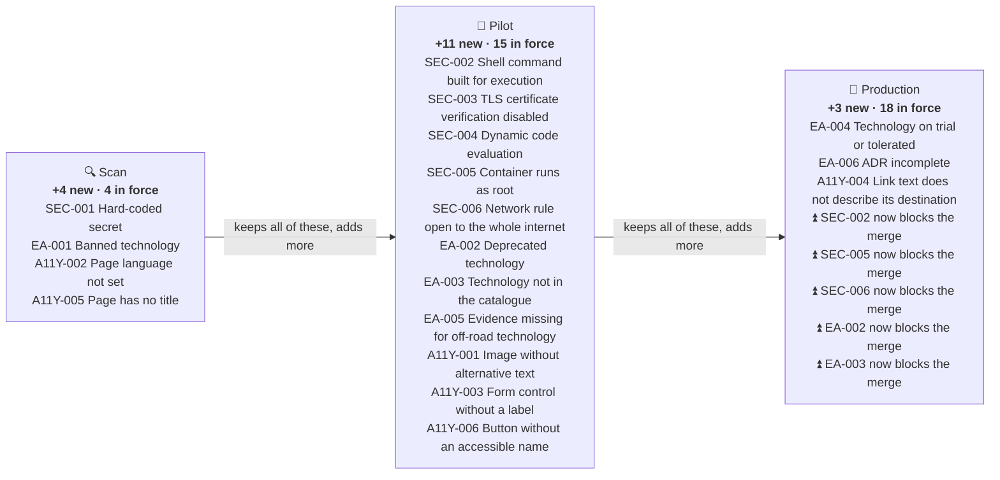

# Guardrails by product stage

A product says how mature it is. The more mature, the more guardrails it must meet, and some get stricter. Each guardrail names the stage it **starts** to apply in, and it then applies to that stage and every later one.



## What each stage means

| Stage | Meaning |
| --- | --- |
| 🔍 **Scan** | exploring an idea; only the must-never-happen guardrails apply |
| 🧪 **Pilot** | real users, limited scope; the everyday guardrails apply |
| 🚀 **Production** | relied upon; every guardrail applies |

## How many guardrails apply

| Stage | Added at this stage | In force | Made stricter at this stage |
| --- | :---: | :---: | :---: |
| 🔍 Scan | 4 | 4 | 0 |
| 🧪 Pilot | 11 | 15 | 0 |
| 🚀 Production | 3 | 18 | 5 |

## Every guardrail, by stage

| Rule | Name | Area | 🔍 Scan | 🧪 Pilot | 🚀 Production |
| --- | --- | --- | :---: | :---: | :---: |
| `SEC-001` | Hard-coded secret | security | ⛔ | ⛔ | ⛔ |
| `SEC-002` | Shell command built for execution | security | ▫️ | ⚠️ | ⛔ |
| `SEC-003` | TLS certificate verification disabled | security | ▫️ | ⛔ | ⛔ |
| `SEC-004` | Dynamic code evaluation | security | ▫️ | ⛔ | ⛔ |
| `SEC-005` | Container runs as root | security | ▫️ | ⚠️ | ⛔ |
| `SEC-006` | Network rule open to the whole internet | security | ▫️ | ⚠️ | ⛔ |
| `EA-001` | Banned technology | enterprise-alignment | ⛔ | ⛔ | ⛔ |
| `EA-002` | Deprecated technology | enterprise-alignment | ▫️ | ⚠️ | ⛔ |
| `EA-003` | Technology not in the catalogue | enterprise-alignment | ▫️ | ⚠️ | ⛔ |
| `EA-004` | Technology on trial or tolerated | enterprise-alignment | ▫️ | ▫️ | ℹ️ |
| `EA-005` | Evidence missing for off-road technology | enterprise-alignment | ▫️ | ⛔ | ⛔ |
| `EA-006` | ADR incomplete | enterprise-alignment | ▫️ | ▫️ | ⚠️ |
| `A11Y-001` | Image without alternative text | accessibility | ▫️ | ⚠️ | ⚠️ |
| `A11Y-002` | Page language not set | accessibility | ⚠️ | ⚠️ | ⚠️ |
| `A11Y-003` | Form control without a label | accessibility | ▫️ | ⚠️ | ⚠️ |
| `A11Y-004` | Link text does not describe its destination | accessibility | ▫️ | ▫️ | ⚠️ |
| `A11Y-005` | Page has no title | accessibility | ⚠️ | ⚠️ | ⚠️ |
| `A11Y-006` | Button without an accessible name | accessibility | ▫️ | ⚠️ | ⚠️ |

⛔ blocks the merge · ⚠️ warning · ℹ️ note · ▫️ does not apply yet

A guardrail can get **stricter** as a product matures: for example a warning at pilot that blocks in production (`escalate: { production: block }` in the rule). Severity can rise with the stage but never fall.

Each area also has its own page with the full wording: [security](policy/security.md), [enterprise-alignment](policy/enterprise-alignment.md), [accessibility](policy/accessibility.md).

## Declaring your stage

Add a `.governance.yml` file to the root of your repository:

```yaml
stage: pilot   # scan | pilot | production
```

Or, if you prefer, put a marker in your `README.md`:

```markdown
<!-- governance-stage: pilot -->
```

A platform team can also set it as a repository setting (the `stage` input of the workflow, from a repository variable), which a pull request cannot change.

| Rule | What it means |
| --- | --- |
| Strictest wins | If it is declared in more than one place, the highest stage applies. |
| A PR can raise it, never lower it | Raising the stage in a pull request re-checks the **whole product**, not only the changed lines. Lowering it has no effect until the lower stage is merged with code owner approval. |
| Not declared | The strictest stage (production) applies, so forgetting never makes a product look safer than it is. |
| Seeing ahead | Findings for guardrails from a later stage are shown in the PR comment under *Coming at a higher stage*, but do not count. |

